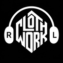
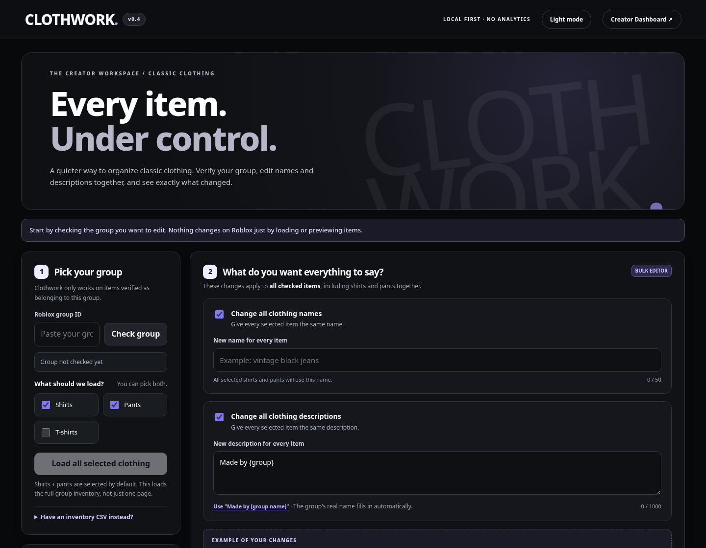
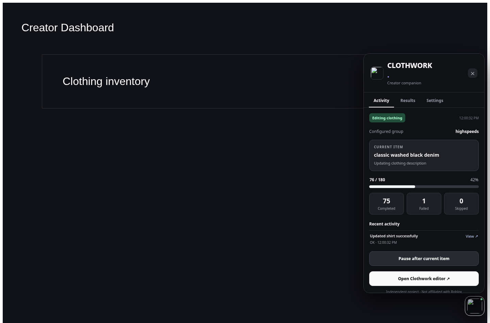

<div align="center">



# CLOTHWORK

**A focused workspace for 2d clothing creators.**

**Website:** https://bordersz.github.io/clothwork/

`Chrome extension` · `JavaScript` · `Manifest V3` · `Local-first`

*Independent project. Not affiliated with Roblox Corporation.*

</div>



<details><summary>See the floating Creator Dashboard panel</summary>



</details>

## What is Clothwork?

Clothwork is a Chrome extension that helps organize classic Roblox shirts, pants and T-shirts. It verifies a group's identity, loads clothing, previews bulk name and description changes, shows a compact companion inside the Creator Dashboard, and keeps local activity/results.

**This repository contains the public read-only portfolio edition.** It does not request Roblox API keys or perform live edits.

## Features

- Confirm the target group ID and limit operations to the intended creator.
- Preview batch names/descriptions, including `{group}` placeholders.
- Write descriptions with paragraphs and blank lines; the editor and preview preserve your spacing.
- Filter shirts, pants, T-shirts; select items individually or in bulk.
- Inspect activity and results in a floating in-page panel.
- Switch between refined **dark and light themes**.
- Export inventory and reports; clear locally saved data.
- Prepare an archive review checklist, with age estimates. **Actual Marketplace archiving remains manual.**

## Description formatting

Type or paste text in **New description for every item** and press Enter to make new lines (Enter twice for an empty line). The preview retains blank lines, and the personal edition submits line breaks as written. Roblox controls how descriptions appear on its own site, so test one asset before a batch update.

## Installation — free

1. Download or clone the repository.
2. Open `chrome://extensions` in Google Chrome.
3. Turn **Developer mode** on.
4. Click **Load unpacked**, then choose the folder that contains `manifest.json`.
5. Open the [Creator Dashboard](https://create.roblox.com/dashboard/creations?activeTab=AvatarItems-classics&filterIndex=0). Click the small Clothwork button, then **Open editor**.
6. Enter the correct group ID and verify it. Load shirts and pants, then preview the changes.

No paid website, external service, or extension store listing is required.

## Safety and privacy

The public build stores relevant inventory and operation state locally in Chrome for resuming and reports; it has no analytics, trackers or developer-operated servers. **Never commit Roblox API keys or cookies.** Review the [privacy policy](docs/PRIVACY.md), [architecture](docs/ARCHITECTURE.md), and [security notes](SECURITY.md).

Roblox's [third-party app policy](https://en.help.roblox.com/hc/en-us/articles/37924211313044-Creator-Third-Party-App-Policy) forbids requesting API keys from other users. The public version intentionally omits credential collection. A future multi-user product requires platform-approved authorization and independent testing.

## Development

Requires Node.js 20+ for tests; the extension itself has **no npm dependencies**.

```bash
npm test
```

## Status

Version **0.4.1** — experimental. The interface and unit tests are locally testable. Roblox APIs and permissions may change; live operation with a real Roblox session is not certified by this repository. This is a portfolio project, not an official Roblox integration.

## Ownership

Copyright © 2026 Clothwork project author. All rights reserved. The source is available for review, not granted for unrestricted redistribution or commercial reuse. There is no open-source license at present.
